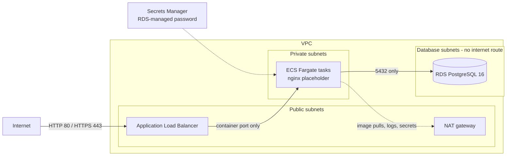

# DevOps Assessment: Terraform + Database Reliability

Terraform design for a production-style AWS stack (**Internet → ALB → ECS/Fargate → RDS PostgreSQL**) with separate dev and prod environments, plus a local PostgreSQL setup with migrations, seed data, query optimisation, and tested backup/restore scripts.

No AWS account is needed to review anything in this repository.

## Reviewer quick start

**Prerequisites:** Docker with Compose v2, Terraform ≥ 1.10, bash.

```bash
# Database tasks (Parts 4-6)
docker compose up -d --wait        # starts Postgres, runs migrations + seed (about 10 s after the image pull)
./scripts/backup.sh                # timestamped dump in backups/
./scripts/restore.sh               # restores the latest dump into a FRESH database: hotel_restore
./scripts/verify-restore.sh        # proves the restore is identical to the source
./scripts/explain-query.sh         # query plan without vs with the index

# Terraform (Parts 1-3): fmt, init, validate, plan -refresh=false, offline
./scripts/tf-check.sh dev
./scripts/tf-check.sh prod
```

Plain `docker compose up` also works (run the scripts from a second terminal); every script waits until the seed has finished before it starts. `make help` lists the same commands as Make targets.

## Repository layout

```
.
├── infra/
│   ├── modules/
│   │   ├── network/        VPC, public/private/database subnets, IGW, NAT, routes
│   │   ├── ecs/            ALB + SG, ECS SG, cluster, task definition, service, autoscaling, IAM
│   │   └── rds/            RDS PostgreSQL, RDS SG, subnet group, parameter group
│   └── envs/
│       ├── dev/            backend.tf, variables.tf, terraform.tfvars, main.tf, ...
│       └── prod/           same layout, larger sizing + guardrail validations
├── db/
│   ├── init/00_init.sh     runs on first container start: migrations, then seed
│   ├── migrations/         001_create_tables.sql, 002_create_indexes.sql
│   ├── seed/               001_seed_data.sql
│   └── queries/            booking_summary.sql (the query to optimise)
├── scripts/
│   ├── backup.sh           timestamped pg_dump + integrity check + checksum + retention
│   ├── restore.sh          restore into a fresh database, checksum-verified
│   ├── verify-restore.sh   compares restored vs source (counts, data checksums, schema)
│   ├── explain-query.sh    EXPLAIN ANALYZE without and with the index
│   ├── tf-check.sh         fmt / init / validate / plan for one environment, offline
│   └── common.sh           shared helpers
├── .github/workflows/
│   ├── terraform.yml       PR: fmt, init, validate, plan → PR comment + artifact + summary
│   └── database.yml        PR: compose up → backup → restore → verify
├── docker-compose.yml
├── Makefile
└── .env.example
```

---

## Part 1: Terraform infrastructure design



### Network isolation

| Tier | Subnets | Route to internet | What runs there |
|---|---|---|---|
| Public | 1 per AZ | Internet gateway | ALB, NAT gateway(s) |
| Private | 1 per AZ | Outbound only, via NAT | ECS/Fargate tasks (`assign_public_ip = false`) |
| Database | 1 per AZ | **None** (local route only) | RDS |

### Security groups (least privilege, chained by security group ID, not CIDR)

| Security group | Inbound | Outbound |
|---|---|---|
| `alb-sg` | 80 (and 443 when a certificate is set) from `0.0.0.0/0` | Container port to `ecs-sg` only |
| `ecs-sg` | Container port from `alb-sg` only | All (RDS, ECR, Secrets Manager, CloudWatch via NAT) |
| `rds-sg` | 5432 from `ecs-sg` only | None |

**How RDS is kept private and ECS-only:** it sits in database subnets with no internet route, has `publicly_accessible = false`, and its only inbound rule references the ECS security group. Nothing else in the VPC, including the ALB, can reach it.

### Other production-oriented choices

- **No passwords anywhere in code or state.** `manage_master_user_password = true` makes RDS generate the password and store it in Secrets Manager. The ECS task definition injects `DB_USER` and `DB_PASSWORD` from that secret at start-up; the execution role can read only that one secret.
- **RDS:** encrypted gp3 storage with storage autoscaling, `rds.force_ssl = 1`, slow-query logging (`log_min_duration_statement = 500`), logs exported to CloudWatch, Performance Insights, IAM authentication enabled, and backup/maintenance windows that don't overlap.
- **ECS:** Fargate in private subnets, rolling deploys with the deployment circuit breaker (automatic rollback on failure), CPU-based autoscaling, Container Insights, and CloudWatch logs with retention. Terraform ignores `desired_count` after creation so it doesn't fight the autoscaler.
- **ALB:** `target_type = "ip"` (required for Fargate), drops invalid headers, and redirects HTTP to HTTPS automatically when `certificate_arn` is set (TLS 1.3 policy).
- **Placeholder app:** `public.ecr.aws/nginx/nginx:1.27-alpine` (ECR Public avoids Docker Hub rate limits). Swap `container_image` and `container_port` for a real backend.

## Part 2: Environment handling

Each environment is its own Terraform root module with its own `variables.tf`, `terraform.tfvars`, and `backend.tf`. Both call the same three modules, so dev and prod differ only in values, never in structure.

| Setting | dev | prod |
|---|---|---|
| State backend | `s3://hotel-booking-tfstate-dev/dev/terraform.tfstate` | `s3://hotel-booking-tfstate-prod/prod/terraform.tfstate` |
| VPC CIDR / AZs | `10.10.0.0/16`, 2 AZs | `10.20.0.0/16`, 3 AZs |
| NAT gateways | 1 shared (cheaper) | 1 per AZ (survives an AZ outage) |
| Fargate task | 0.25 vCPU / 512 MiB | 1 vCPU / 2 GiB |
| Task count (desired / min / max) | 1 / 1 / 2 | 2 / 2 / 6 |
| RDS instance | `db.t4g.micro`, 20 GiB (max 50) | `db.r6g.large`, 100 GiB (max 500) |
| RDS Multi-AZ | No | Yes |
| **RDS backup retention** | **1 day** | **30 days** |
| **RDS deletion protection** | **false** | **true** |
| Final snapshot on destroy | Skipped | Taken |
| RDS changes applied | Immediately | In the maintenance window |
| ALB deletion protection | false | true |
| Log retention | 7 days | 90 days |

**Prod guardrails.** `infra/envs/prod/variables.tf` has validation rules that make Terraform refuse to plan an unsafe prod configuration: deletion protection off, backup retention under 7 days, single-AZ RDS, skipping the final snapshot, a single NAT gateway, or fewer than 2 tasks. For example:

```
$ terraform plan -var db_deletion_protection=false -var db_backup_retention_period=1 ...
Error: Invalid value for variable
  Prod must keep automated backups for at least 7 days.
Error: Invalid value for variable
  Prod RDS must have deletion protection enabled.
```

**State.** Separate buckets and keys mean a dev run can never read or overwrite prod state. Both use encryption and S3 native state locking (`use_lockfile = true`, Terraform ≥ 1.10), so two applies can't run at the same time. Ideally each environment lives in its own AWS account, with prod state readable only by the CI deploy role and a few admins.

### Validating Terraform without AWS

The S3 backend and real AWS credentials aren't available to reviewers, so `scripts/tf-check.sh` runs the review commands in **plan-only mode**:

1. It writes a temporary, gitignored `backend_override.tf` that swaps the S3 backend for a local one (Terraform's standard [override file](https://developer.hashicorp.com/terraform/language/files/override) mechanism), so `init` doesn't need the bucket.
2. It passes `-var plan_only=true`, which makes the AWS provider use mock credentials and skip its start-up API calls. With `-refresh=false`, the plan makes no AWS calls at all.

```bash
./scripts/tf-check.sh dev     # Plan: 47 to add, 0 to change, 0 to destroy.
./scripts/tf-check.sh prod    # Plan: 59 to add, 0 to change, 0 to destroy.
```

The full plan is written to `infra/envs/<env>/plan.txt`. To run the commands by hand instead:

```bash
cd infra/envs/dev
printf 'terraform {\n  backend "local" {}\n}\n' > backend_override.tf
terraform fmt -check -recursive ../..
terraform init
terraform validate
terraform plan -refresh=false -var plan_only=true
rm backend_override.tf
```

For a real deployment: create the state buckets, delete any `backend_override.tf`, run `terraform init -reconfigure`, and plan/apply without `plan_only`.

## Part 3: Terraform plan in GitHub (optional part, implemented)

`.github/workflows/terraform.yml` runs on every pull request that changes `infra/`:

1. `terraform fmt -check -recursive`
2. For **dev and prod in parallel**: `init` → `validate` → `plan` (saved with `-out`)
3. The plan is shared **all three ways the assessment lists**:
   - **PR comment:** one sticky comment per environment, updated on each push (no comment spam), with the `Plan: X to add...` summary at the top and the full plan collapsed
   - **Workflow artifact:** `terraform-plan-dev` / `terraform-plan-prod`
   - **Workflow output:** the run's summary page

It runs in plan-only mode by default, so it works in any fork with no secrets. Setting a repository variable `AWS_PLAN_ROLE_ARN` (a read-only IAM role trusted for GitHub OIDC) switches it to real credentials and the real S3 backend, with no long-lived AWS keys.

`.github/workflows/database.yml` additionally runs the full database flow (compose up, backup, restore, verify, explain) on PRs that touch `db/` or `scripts/`.

---

## Part 4: Local database

`docker-compose.yml` runs **PostgreSQL 16**. On first start, `db/init/00_init.sh` applies every file in `db/migrations/` in order, then `db/seed/`. The healthcheck uses TCP, so the container only reports healthy after seeding has finished.

| Default | Value | Override |
|---|---|---|
| Database | `hotel` | `DB_NAME` |
| User / password | `hotel_user` / `hotel_local_only` | `DB_USER`, `DB_PASSWORD` |
| Host port | `5432` | `DB_PORT` (change it if 5432 is already in use) |

Copy `.env.example` to `.env` to override any of these. Open a SQL shell with `make psql`.

**Schema** (`db/migrations/001_create_tables.sql`) follows the suggested schema, plus constraints that keep data consistent:

- `checkout_date > checkin_date`, `amount >= 0`, and `status` limited to known values
- `city = lower(city)`, so a filter like `city = 'delhi'` always matches and can use a plain B-tree index
- `booking_events.booking_id` is a foreign key to `hotel_bookings(id)` with `ON DELETE CASCADE`

## Part 5: Seed data and indexing

### Seed data

`db/seed/001_seed_data.sql` generates (with a fixed random seed):

| Requirement | Seeded |
|---|---|
| ≥ 100 hotel bookings | **50,000** (configurable with `SEED_BOOKING_COUNT`) |
| Multiple cities | 10 (delhi, mumbai, bengaluru, hyderabad, chennai, kolkata, pune, jaipur, goa, gurugram) |
| Multiple organisations | 8 |
| Multiple statuses | 6: confirmed 40%, completed 25%, cancelled 15%, pending 10%, checked_in 5%, refunded 5% |
| Events for some bookings | about 70% of bookings, about 115,000 events, matched to each booking's status (created → paid → confirmed → checked in → checked out, or cancelled → refunded) with JSONB payloads |

Bookings are spread over the last 365 days, so the 30-day query always returns data (about 400 rows for Delhi).

**Why 50,000 rows instead of 100:** at 100 rows the whole table fits in a single 8 KB page, and Postgres correctly chooses a sequential scan, so no index can show a benefit. 50,000 rows still loads in about 3 seconds and makes `EXPLAIN` meaningful. `SEED_BOOKING_COUNT=100 docker compose up` seeds exactly the minimum.

### Query optimisation

```sql
SELECT org_id, status, COUNT(*), SUM(amount)
FROM hotel_bookings
WHERE city = 'delhi'
  AND created_at >= NOW() - INTERVAL '30 days'
GROUP BY org_id, status;
```

**Index added** (`db/migrations/002_create_indexes.sql`):

```sql
CREATE INDEX idx_hotel_bookings_city_created_at
    ON hotel_bookings (city, created_at)
    INCLUDE (org_id, status, amount);
```

**Why this index:**

1. **`city` first:** it's an equality filter, so the index jumps straight to the Delhi entries.
2. **`created_at` second:** it's a range filter. Within Delhi, entries are sorted by time, so Postgres reads only the last 30 days and stops. The equality column must come before the range column; with `(created_at, city)`, Postgres would have to read every city's last-30-days entries and filter them.
3. **`INCLUDE (org_id, status, amount)`:** these columns are stored in the index leaf pages but aren't part of the search key, so they don't affect ordering. Everything the query needs is in the index, so Postgres can do an **index-only scan** and never read the table.

**Result** (`./scripts/explain-query.sh`, 50,000 bookings):

```
WITHOUT index
 HashAggregate (actual time=6.646..6.659 rows=47 loops=1)
   Buffers: shared hit=730
   ->  Seq Scan on hotel_bookings (actual time=0.130..6.359 rows=414 loops=1)
         Filter: (((city)::text = 'delhi'::text) AND (created_at >= (now() - '30 days'::interval)))
         Rows Removed by Filter: 49586
 Execution Time: 6.740 ms

WITH index
 HashAggregate (actual time=0.264..0.275 rows=47 loops=1)
   Buffers: shared hit=11
   ->  Index Only Scan using idx_hotel_bookings_city_created_at on hotel_bookings (actual time=0.046..0.119 rows=414 loops=1)
         Index Cond: ((city = 'delhi'::text) AND (created_at >= (now() - '30 days'::interval)))
         Heap Fetches: 0
 Execution Time: 0.307 ms
```

Pages read drop from 730 to 11 (about 66x fewer) and execution time from 6.7 ms to 0.3 ms. `Heap Fetches: 0` confirms the table itself is never touched. The gap grows with table size, because the sequential scan grows with the whole table while the index scan grows only with the matching rows.

**Alternatives considered:**

- **Partial index `WHERE created_at >= NOW() - INTERVAL '30 days'`:** not possible. Index predicates must be immutable and `NOW()` isn't; a fixed date would go stale.
- **Partial index `WHERE city = 'delhi'`:** smaller, but only helps one city. The composite index serves the same report for every city.
- **Separate indexes on `city` and `created_at`:** Postgres would need a bitmap AND of both, then still visit the table for `org_id`, `status`, and `amount`.
- **Index on `lower(city)`:** unnecessary, because the `city = lower(city)` constraint guarantees stored values are already lowercase.

**Trade-off:** each insert also updates this index (a small write cost), and the index takes disk space. For a reporting query on a read-heavy bookings table, that's a good trade.

`booking_events` also gets an index on `(booking_id, created_at)`. PostgreSQL doesn't index foreign keys automatically; this one speeds up "events for a booking" lookups and stops `ON DELETE CASCADE` from scanning the whole events table.

## Part 6: Backup and restore

### `scripts/backup.sh`

- Runs `pg_dump` inside the container in custom format (`-Fc`: compressed, restorable with `pg_restore`)
- Writes `backups/<db>_<YYYYmmdd_HHMMSS>.dump`, for example `backups/hotel_20261023_054731.dump` (about 5 MB)
- Writes to a `.partial` file first and renames it only on success, so a failed run never leaves a broken backup
- Checks the archive is readable (`pg_restore --list`) and writes a `.sha256` checksum next to it
- Deletes local backups older than `BACKUP_RETENTION_DAYS` (default 7)

### `scripts/restore.sh [backup_file] [target_db]`

- Defaults to the newest backup and a target database named `hotel_restore`
- Checks the `.sha256` checksum first and refuses a corrupted or modified file
- **Drops and re-creates the target database every run, so it always restores into a fresh database**
- Restores with `--single-transaction --exit-on-error`: either everything is restored or nothing is
- Refuses to restore over the source database `hotel` unless `ALLOW_OVERWRITE_SOURCE=yes` is set

### How to verify the restore worked

Run the automated check:

```bash
./scripts/verify-restore.sh
```

It compares the source database (`hotel`) with the restored one (`hotel_restore`) and exits non-zero on any difference:

```
[05:47:34] Comparing 'hotel' (source) with 'hotel_restore' (restored)

  PASS  hotel_bookings row count           50000
  PASS  booking_events row count           115883
  PASS  hotel_bookings data checksum       46dbc5d58980056f09eac140e1147065
  PASS  booking_events data checksum       32f2080942f896f20ca092711c23580a
  PASS  indexes                            booking_events_pkey,hotel_bookin
  PASS  constraints                        7 constraints
  PASS  booking_events id sequence         115883
  PASS  reporting query result             5bd95160ed99ef29d073299b153962a1

[05:47:36] RESTORE VERIFIED: 'hotel_restore' is identical to 'hotel'
```

| Check | What it proves |
|---|---|
| Row counts | No rows were lost |
| Data checksums | An MD5 over every row's content (ordered by `id`) matches, so the data is identical, not just the same size |
| Indexes and constraints | The schema came back too, including the optimisation index and foreign key |
| Sequence value | New `booking_events` inserts won't collide with restored IDs |
| Reporting query result | The restored database gives the same business answer |

The verification really does catch problems. Changing one amount in the restored copy gives:

```
  FAIL  hotel_bookings data checksum       source=46dbc5d5... restored=b861b30e...
ERROR: 1 check(s) failed: the restored database does not match the source
```

To check by hand instead:

```bash
docker compose exec db psql -U hotel_user -d hotel         -c "SELECT count(*) FROM hotel_bookings" -c "SELECT count(*) FROM booking_events"
docker compose exec db psql -U hotel_user -d hotel_restore -c "SELECT count(*) FROM hotel_bookings" -c "SELECT count(*) FROM booking_events"
docker compose exec db psql -U hotel_user -d hotel_restore -c "\di"     # indexes restored
```

Compare right after backing up and restoring. If the source database changes in between, the comparison will (correctly) show a difference.

---

## Troubleshooting

| Problem | Fix |
|---|---|
| `port is already allocated` on 5432 | Set `DB_PORT=5433` in `.env`, then `docker compose up -d` |
| `the 'db' container is not running` | Run `docker compose up -d --wait` first |
| `permission denied` running a script | `chmod +x scripts/*.sh` (Git normally keeps the executable bit) |
| `$'\r': command not found` (Windows) | Line endings were converted to CRLF. `.gitattributes` forces LF; re-clone, or run `git config core.autocrlf false` and check out again |
| Want a clean, re-seeded database | `docker compose down -v && docker compose up -d --wait` (`make reset`) |
| Terraform `init` fails on the S3 backend | Use `./scripts/tf-check.sh`, or add the `backend_override.tf` shown above |

## What I'd add for a real production rollout

- A small bootstrap stack that creates the state buckets with versioning, encryption, and public access block
- Ship local `backup.sh` dumps to S3 with lifecycle rules, and test restores on a schedule, not only on demand
- Route 53 + ACM certificate for HTTPS, and AWS WAF on the ALB
- VPC endpoints for ECR, Secrets Manager, and CloudWatch Logs to cut NAT costs and keep that traffic private
- CloudWatch alarms (ALB 5xx, target health, RDS CPU, free storage, replica lag) wired to on-call
- RDS Proxy if the application opens many short-lived connections
- `tflint`, `checkov`, and Infracost in the Terraform workflow; a manual-approval `apply` job gated on the reviewed plan
